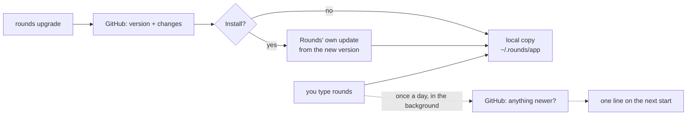
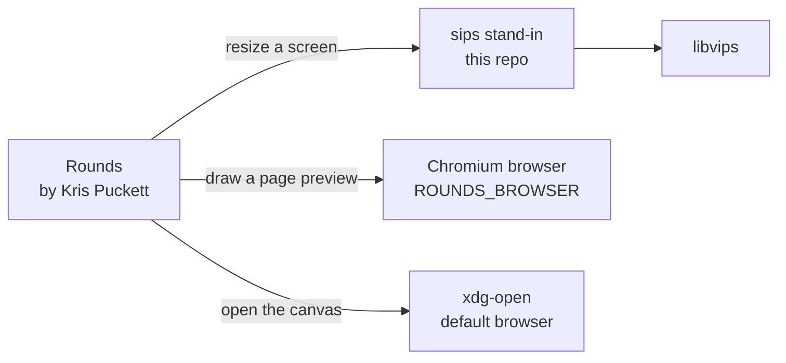

# Rounds-Linux

**Run [Rounds](https://github.com/krispuckett/rounds) on Linux.**

> **Rounds is made by [Kris Puckett](https://krispuckett.com).** All the credit for Rounds (the canvas, the indexer, the notes that go back to your Claude Code sessions, the design) belongs to him. Get it, star it and follow it at **[github.com/krispuckett/rounds](https://github.com/krispuckett/rounds)**.
>
> This repo is an unofficial, community companion. It contains **none of Rounds' code**. It only adds the small pieces Rounds expects to find on a Mac, plus notes on setting it up on Linux. It isn't affiliated with or endorsed by Kris Puckett. Problems with Rounds on Linux belong here, not in his repo.

Rounds is a local canvas of everything your Claude Code sessions make: screens, pages and pushes, sorted by project, with a timeline, before/after comparisons, and notes you pin on a screen that go back to the session that made it. Its README says it needs a Mac. In practice Rounds already runs on Linux. It just turns two features down when it can't find Mac tools:

| What | On a Mac | On Linux, out of the box | With Rounds-Linux |
|---|---|---|---|
| The canvas, notes, timeline, search | ✅ | ✅ | ✅ |
| Reading Claude Code sessions (`~/.claude/projects`) | ✅ | ✅ | ✅ |
| Screens resized for the canvas | ✅ macOS `sips` | ❌ sent full size (slower with many screenshots) | ✅ `sips` stand-in, backed by libvips |
| Page previews (thumbnails of published HTML pages) | ✅ finds Chrome | ⚠️ only if Chrome, Chromium, Edge or Brave is on your `PATH` | ✅ also any other Chromium browser, via `ROUNDS_BROWSER` |
| Claude **desktop app** sessions | ✅ | ❌ that app's folder is Mac-only | ❌ |

Tested on CachyOS (Arch), Node 26, npm 12, libvips 8.18, Rounds 1.1.1.

## Set up

1. **Install libvips** if you don't have it:
   ```sh
   sudo pacman -S libvips          # Arch / CachyOS
   sudo apt install libvips-tools  # Debian / Ubuntu
   sudo dnf install vips-tools     # Fedora
   ```
2. **Run the installer.** It puts `sips` and the `rounds` launcher in `~/.local/bin` and checks Node, libvips and your browser:
   ```sh
   git clone https://github.com/shreejanbista/Rounds-Linux
   cd Rounds-Linux
   ./install.sh
   ```
3. **Page previews** (optional). If your Chromium-based browser isn't Chrome, Chromium, Edge or Brave (for example Helium, Vivaldi, or any AppImage), point Rounds at it:
   ```sh
   export ROUNDS_BROWSER=/path/to/browser    # bash/zsh: add to ~/.bashrc or ~/.zshrc
   set -Ux ROUNDS_BROWSER /path/to/browser   # fish
   ```
   Rounds runs it hidden (headless) only to draw thumbnails. The canvas itself always opens in your **default** browser.
4. **Try Rounds**, exactly as its README says, with one extra flag:
   ```sh
   npx --allow-git=root github:krispuckett/rounds --demo   # sample work; reads nothing of yours
   npx --allow-git=root github:krispuckett/rounds          # your own sessions
   ```
   **Why `--allow-git=root`:** npm 12 refuses packages that come straight from GitHub unless you allow it. `root` allows only Rounds itself, not any of its dependencies, and doesn't change your npm settings.

5. **Set it up for real** with Rounds' own `init`. It adds Rounds' MCP server, skill and hooks to Claude Code, asks before each one, and keeps a copy of Rounds in `~/.rounds/app`:
   ```sh
   cd ~ && npx --allow-git=root github:krispuckett/rounds init
   ```
   Run it from your home folder. Inside a git repo it also offers to record that repo's pushes (fine either way, but easy to say yes to by accident).
6. **From then on, just type `rounds`.** See below.

Everything Rounds does is as Kris made it; see [Rounds' README](https://github.com/krispuckett/rounds#readme).

## `rounds` and `rounds upgrade`

Rounds' README starts it with `npx github:krispuckett/rounds`, which goes to GitHub every time and quietly moves you to whatever is newest. [`bin/rounds`](bin/rounds) runs the copy that `init` made instead, so starting is instant and works offline, and Rounds only changes when you say so.

| Command | Does |
|---|---|
| `rounds` | Opens the canvas from `~/.rounds/app`. No network needed. |
| `rounds <anything else>` | Passed straight to Rounds, unchanged: `--demo`, `init`, `index`, `uninstall`, and Rounds' own `update`. |
| `rounds upgrade` | Checks GitHub for a newer Rounds, shows the new version and **what changed since your build** (Kris's own commit messages, newest first, plus a link to every changed line), then asks `Install it? [y/N]`. |
| `rounds upgrade --check` | The same, but only shows; installs nothing. |
| `rounds upgrade --yes` | Installs without asking. |

**Staying informed without waiting on the network:** at most once a day, `rounds` checks GitHub in the background while the canvas starts. When a newer Rounds is out, the next start prints one line, `Rounds 1.2.0 is out: run rounds upgrade to see what's new.`, and nothing else. Offline, nothing happens at all.

**Why `upgrade`, not `update`:** Rounds already has an `update` command (it brings the hooks' copy in line with the version you ran). We leave it alone. `rounds upgrade` installs a new version *by running Rounds' own `update` from it*, so Rounds still does the swap its own way: it replaces `~/.rounds/app` in one go and refreshes the skill. Your canvas, notes and settings aren't touched.

Which build you have is kept in `~/.rounds/rounds-linux.json`. Without a GitHub token you get 60 GitHub requests an hour, far more than this needs; set `GITHUB_TOKEN` if you're ever limited.



## How it fits together



## The `sips` stand-in

Rounds calls macOS's `sips` in exactly two ways, and [`bin/sips`](bin/sips) handles exactly those:

| Rounds runs | The stand-in does |
|---|---|
| `sips -Z <size> -s format jpeg -s formatOptions <q> <src> --out <out>` | `vips thumbnail`: fits the longest side to `<size>`, never enlarges, saves JPEG at quality `<q>`, puts transparency on white, strips metadata. Writes to a temp file first, so a half-written image is never picked up. |
| `sips -g pixelWidth -g pixelHeight <file>` | Prints the size in `sips`' own format |

Anything else (unknown options, a missing or broken file) exits with an error, and Rounds then falls back to the original image, just as it does without `sips`. Nothing else on Linux uses the name `sips`.

**One difference from a Mac:** real `sips -Z` also enlarges small images; this one leaves them at their own size, which gives smaller files. The canvas scales them anyway.

Test it: `tests/test-sips.sh` (needs ImageMagick to make the test images). The launcher has its own: `tests/test-rounds.sh`, which uses a pretend GitHub and a pretend Rounds, so nothing real is downloaded or changed.

## Notes

- **The demo uses port 4795**, the real canvas uses 4797 (or `port` in `~/.rounds/config.json`). Both listen on `127.0.0.1` only.
- **Topic sorting uses Claude Haiku** through your own Claude Code (`claude` on your `PATH`), sending each screen's caption, session name and file names. That's how Rounds is designed; see its Privacy section.
- **Uninstall:** `rm ~/.local/bin/sips ~/.local/bin/rounds ~/.rounds/rounds-linux.json`. To remove Rounds itself, run `rounds uninstall` (Rounds' own), then delete `~/.rounds` if you want your canvas gone too.

## Credits

- **[Rounds](https://github.com/krispuckett/rounds)** © Kris Puckett, MIT License. Everything that makes Rounds good is his work.
- **[libvips](https://www.libvips.org/)** does the image work behind the stand-in.
- Rounds-Linux is MIT licensed; see [LICENSE](LICENSE).
